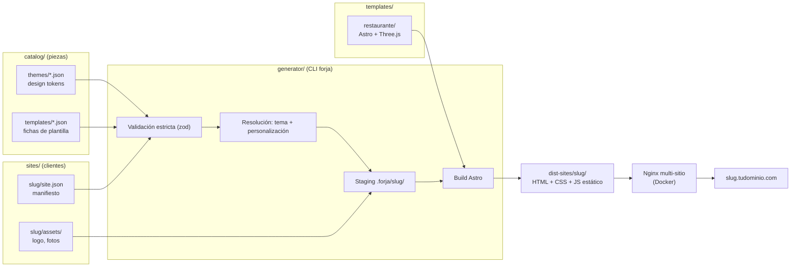
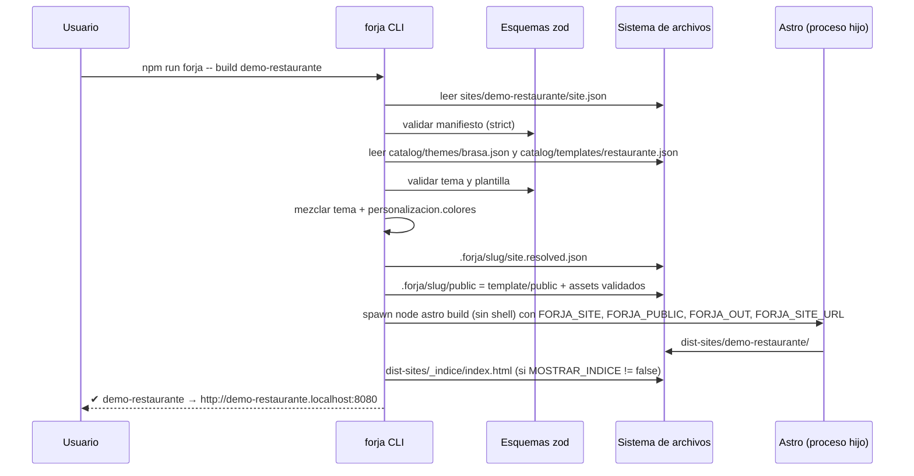
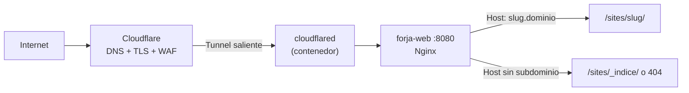
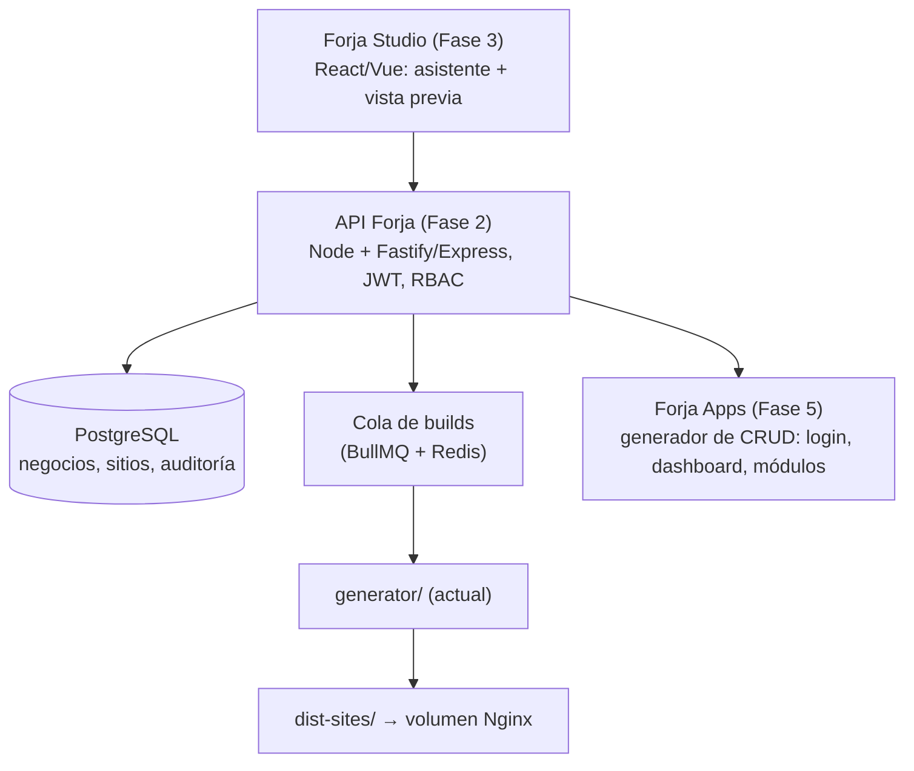

# 02 · Arquitectura

## 1. Vista general

## 2. Componentes

| Componente | Ruta | Tecnología | Responsabilidad |
|---|---|---|---|
| Catálogo de temas | `catalog/themes/` | JSON | Colores, tipografía, radio de bordes, tipo de escena 3D |
| Catálogo de plantillas | `catalog/templates/` | JSON | Metadatos: id, versión, sector, secciones, sitio de ejemplo |
| Generador | `generator/` | Node.js 20+ (ESM), zod 4 | CLI, validación, resolución, staging, invocar Astro, índice |
| Plantilla restaurante | `templates/restaurante/` | Astro 7, Three.js 0.187, CSS moderno | Renderizar el sitio desde el JSON resuelto |
| Sitios | `sites/<slug>/` | JSON + imágenes | Datos de cada negocio |
| Servidor | `deploy/nginx/` + `Dockerfile` | Nginx unprivileged 1.29 (alpine) | Servir los sitios por subdominio, con cabeceras de seguridad |
| Orquestación | `docker-compose.yml` | Docker Compose | Servicio `web` y túnel opcional `tunnel` (Cloudflare) |

## 3. Flujo de ensamblaje (`forja build <slug>`)

### Variables de entorno de la plantilla

| Variable | Uso |
|---|---|
| `FORJA_SITE` | Ruta del JSON resuelto; lo lee `src/lib/site.ts` en tiempo de build |
| `FORJA_PUBLIC` | Carpeta `public` combinada (plantilla + assets del cliente) |
| `FORJA_OUT` | Carpeta de salida `dist-sites/<slug>` |
| `FORJA_SITE_URL` | URL pública (canonical, Open Graph, JSON-LD) |

## 4. Enrutamiento en producción

Nginx extrae el slug del subdominio con `server_name ~^(?<slug>...)\.` y usa `root /usr/share/nginx/html/sites/$slug`. El slug debe contener al menos una letra, para que una IP como `192.168.1.10` no se interprete como slug.

## 5. Decisiones de arquitectura (ADR)

| # | Decisión | Alternativas | Motivo |
|---|---|---|---|
| ADR-01 | Sitios **estáticos** (SSG) con Astro | Next.js SSR, WordPress | Hosting casi gratis, máxima velocidad, superficie de ataque mínima (sin servidor de aplicación ni BD expuesta) |
| ADR-02 | Plantillas **alimentadas por datos** (JSON), no plantillas de texto (Handlebars) | Handlebars/EJS reemplazando texto en código | Evita la inyección de plantillas (SSTI); el código de la plantilla es siempre el mismo y se puede auditar |
| ADR-03 | Validación con **zod en modo strict** | JSON Schema/ajv | Mensajes claros en español y rechazo de campos desconocidos |
| ADR-04 | **Three.js procedural** (sin modelos .glb) en la v0.1 | Spline, modelos .glb | Cero assets pesados y colores 100 % ligados al tema. Se pueden agregar .glb en la Fase 4 |
| ADR-05 | Animaciones de scroll con **CSS scroll-driven** (`animation-timeline`) | GSAP + ScrollTrigger | Sin JS ni bibliotecas; mejora progresiva (en navegadores sin soporte el contenido simplemente aparece) |
| ADR-06 | **Una imagen Nginx para todos los sitios**, enrutada por subdominio | Un contenedor por cliente | Consume pocos recursos en Proxmox y es fácil de operar |
| ADR-07 | **Cloudflare Tunnel** para publicar | Abrir puertos 80/443 del router | No expone la IP pública ni requiere abrir puertos; TLS y WAF incluidos |
| ADR-08 | Fuentes del sistema (sin Google Fonts) | Google Fonts | Privacidad (sin terceros), rendimiento y una CSP más simple |

## 6. Evolución prevista (Fases 2-5)

- La **API** reemplazará la edición manual de `site.json`: el Studio guarda en PostgreSQL y exporta el manifiesto al generador.
- Los **builds** se ejecutarán en una cola, para no bloquear la API ni permitir ejecuciones concurrentes peligrosas.
- **Forja Apps** reutiliza la misma idea: un manifiesto describe las entidades (campos y tipos), el stack (React/Vue/Angular + Node/Python + Postgres/Mongo) y el tema, y el generador produce el código con su `docker-compose.yml`.
