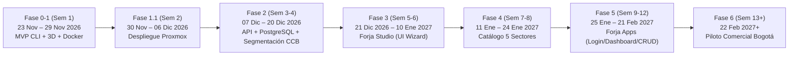

# 03 · Cronograma del Proyecto — Forja Modular

**Zona horaria de referencia:** `America/Bogota` (UTC-5)  
**Fecha base de inicio:** Lunes 23 de noviembre de 2026 (`2026-11-23`)

---

## 1. Ejecución Real — Día 1 (2026-11-23)

Registro cronológico exacto de las actividades ejecutadas hoy durante las Fases 0 y 1:

| Fecha y Hora (UTC-5) | Fase | Actividad | Entregable / Verificación | Estado |
|---|---|---|---|---|
| `2026-11-23 10:38` | Fase 0 | Conceptualización de plataforma de ensamblaje modular (App/Site Generator + White-label Design Tokens + Docker) | Definición funcional y arquitectura base | ✅ Completado |
| `2026-11-23 10:45` | Fase 0 | Incorporación de línea **Forja Sitios (WaaS 3D)** y análisis normativo de base de datos CCB (Ley 1581/2012 y Ley 2300/2023) | Alcance técnico y marco de cumplimiento | ✅ Completado |
| `2026-11-23 10:50` | Fase 0 | Auditoría de entorno local (`Node v24.11.0`, `npm 11.6.1`, `Git 2.51.0`, `Docker 29.1.3`) e inicialización de monorepo npm workspaces | [package.json](file:///d:/piza77/proyectos/APLICACION__MODULAR/package.json), [.gitignore](file:///d:/piza77/proyectos/APLICACION__MODULAR/.gitignore), [.dockerignore](file:///d:/piza77/proyectos/APLICACION__MODULAR/.dockerignore), [.env.example](file:///d:/piza77/proyectos/APLICACION__MODULAR/.env.example) | ✅ Completado |
| `2026-11-23 10:52` | Fase 1 | Creación del catálogo de temas (*design tokens*) y ficha de plantilla | [brasa.json](file:///d:/piza77/proyectos/APLICACION__MODULAR/catalog/themes/brasa.json), [oceano.json](file:///d:/piza77/proyectos/APLICACION__MODULAR/catalog/themes/oceano.json), [bosque.json](file:///d:/piza77/proyectos/APLICACION__MODULAR/catalog/themes/bosque.json), [restaurante.json](file:///d:/piza77/proyectos/APLICACION__MODULAR/catalog/templates/restaurante.json) | ✅ Completado |
| `2026-11-23 10:54` | Fase 1 | Implementación del motor generador CLI y esquemas de validación estricta (`zod` strict mode, anti-path traversal, filtro anti-XSS en SVG) | [schema.mjs](file:///d:/piza77/proyectos/APLICACION__MODULAR/generator/src/schema.mjs), [generate.mjs](file:///d:/piza77/proyectos/APLICACION__MODULAR/generator/src/generate.mjs), [forja.mjs](file:///d:/piza77/proyectos/APLICACION__MODULAR/generator/bin/forja.mjs) | ✅ Completado |
| `2026-11-23 10:56` | Fase 1 | Desarrollo de plantilla `restaurante` en Astro 7 + Three.js 0.187 (carga diferida 3D, tarjetas tilt 3D, SEO JSON-LD, página legal Ley 1581) | `templates/restaurante/src/**` | ✅ Completado |
| `2026-11-23 10:59` | Fase 1 | Creación de manifiestos de sitios de referencia y validación real de build estático (`demo-restaurante` en 3.0s y `demo-cevicheria` en 4.1s) | [demo-restaurante/site.json](file:///d:/piza77/proyectos/APLICACION__MODULAR/sites/demo-restaurante/site.json), [demo-cevicheria/site.json](file:///d:/piza77/proyectos/APLICACION__MODULAR/sites/demo-cevicheria/site.json) | ✅ Completado |
| `2026-11-23 11:02` | Fase 1 | Empaquetado multi-etapa Docker (`node:24-alpine` → `nginx-unprivileged:1.29-alpine`) con CSP estricta, rate-limiting y perfil Cloudflare Tunnel | [Dockerfile](file:///d:/piza77/proyectos/APLICACION__MODULAR/Dockerfile), [docker-compose.yml](file:///d:/piza77/proyectos/APLICACION__MODULAR/docker-compose.yml), [default.conf](file:///d:/piza77/proyectos/APLICACION__MODULAR/deploy/nginx/default.conf), [seguridad.conf](file:///d:/piza77/proyectos/APLICACION__MODULAR/deploy/nginx/seguridad.conf) | ✅ Completado |
| `2026-11-23 11:06` | Fase 1 | Adopción formal de reglas de gobernanza arquitectónica ("Prevención de las 4 D" y protocolo de ciberseguridad) y documentación técnica | `documentacion/00_INDICE.md` a `11_BITACORA.md` | 🔄 En curso |

---

## 2. Planificación de Fases Siguientes (Hoja de Ruta)

Cronograma estimado trabajando a ritmo constante, con entregables verificables al cierre de cada semana:

### Detalle por Fase

| Fase | Ventana Calendario | Objetivo Técnico | Criterio de Aceptación (DoD) |
|---|---|---|---|
| **Fase 1.1** | `2026-11-30` al `2026-12-06` | Puesta en marcha en servidor **Proxmox VE** | VM Debian 12 / Ubuntu 24.04 con Docker rootless o endurecido, contenedor `forja-web` activo, wildcard DNS en Cloudflare Tunnel (`*.tudominio.com`) y backup automático PVE programado. |
| **Fase 2** | `2026-12-07` al `2026-12-20` | Backend de gestión y analítica de segmentación | API REST con Node.js + PostgreSQL, autenticación Argon2id + JWT, módulo local de analítica/segmentación de la base CCB (sin envío masivo automatizado) y bitácora de auditoría. |
| **Fase 3** | `2026-12-21` al `2027-01-10` | **Forja Studio** (Constructor visual web) | Interfaz web para elegir plantilla, tema, colores, subir assets validados, previsualizar el sitio en vivo y disparar el build en cola. |
| **Fase 4** | `2027-01-11` al `2027-01-24` | Expansión del catálogo sectorial | 4 plantillas nuevas: `ferreteria-industrial`, `belleza-spa`, `consultorio-salud`, `servicios-profesionales`. |
| **Fase 5** | `2027-01-25` al `2027-02-21` | **Forja Apps** (Generador Full-Stack) | Ensamblador de aplicaciones con selección de template de Login, template de Dashboard, esquema de entidades/campos de BD y generación de `docker-compose.yml` (Frontend + Backend + DB). |
| **Fase 6** | `2027-02-22` en adelante | Piloto comercial con negocios de Bogotá | 5 a 10 clientes reales en producción sobre Proxmox, monitoreo de disponibilidad y validación del flujo legal de autorización de datos. |
