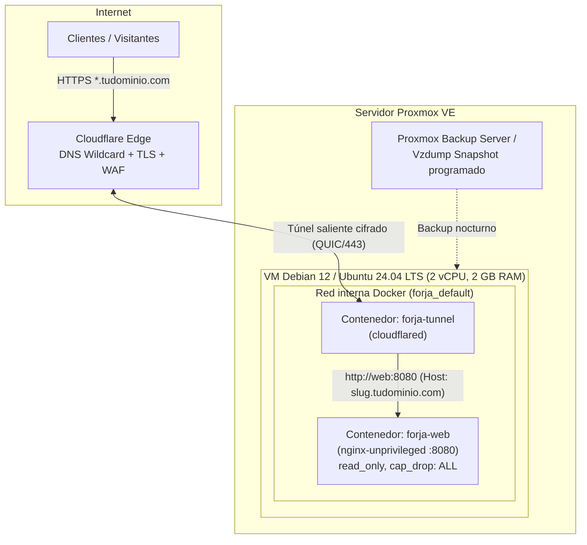

# 07 · Guía de Despliegue en Servidor Proxmox VE

Esta guía detalla paso a paso cómo desplegar **Forja Modular** en tu servidor **Proxmox VE (PVE)** con aislamiento de seguridad, consumo mínimo de recursos y publicación segura hacia Internet sin abrir puertos en tu router.

---

## 1. Arquitectura en Proxmox VE



### ¿VM (KVM) o Contenedor LXC para correr Docker?
> [!IMPORTANT]
> **Recomendación oficial de Proxmox y de seguridad:** Usa una **Máquina Virtual (KVM)** ligera con Debian 12 o Ubuntu Server 24.04 LTS en lugar de un LXC para alojar Docker.
> - **Por qué:** Una VM tiene su propio kernel aislado, soporta `cap_drop: ALL`, `read_only: true` y actualizaciones del kernel de Proxmox sin romper AppArmor/cgroups de Docker.

---

## 2. Dimensionamiento de la VM en Proxmox

Un solo contenedor `forja-web` puede servir **cientos de sitios estáticos** con menos de **50 MB de RAM**:

| Recurso | Valor Recomendado (Fase 1: solo sitios) | Valor Recomendado (Fase 2-3: con PostgreSQL + API + Studio) |
|---|---|---|
| **Sistema Operativo** | Debian 12 (Bookworm) netinst | Debian 12 (Bookworm) netinst |
| **Tipo de CPU** | `host` (2 vCores) | `host` (4 vCores) |
| **Memoria RAM** | `2048 MB` (Ballooning desactivado o mín. 1024 MB) | `4096 MB` |
| **Disco** | `20 GB` VirtIO SCSI (`discard=on`, `ssd=1`) | `40 GB` VirtIO SCSI (`discard=on`, `ssd=1`) |
| **QEMU Guest Agent** | Habilitado | Habilitado |

---

## 3. Preparación de la VM (Comandos en la consola Linux)

### 3.1 Actualizar sistema e instalar QEMU Guest Agent y Firewall
```bash
sudo apt update && sudo apt full-upgrade -y
sudo apt install -y qemu-guest-agent curl git ca-certificates ufw
sudo systemctl enable --now qemu-guest-agent
```

### 3.2 Configurar Firewall local (`ufw`)
Si publicas con **Cloudflare Tunnel**, no necesitas exponer el puerto 8080 fuera de tu LAN:
```bash
sudo ufw default deny incoming
sudo ufw default allow outgoing
# Permitir SSH y acceso de prueba solo desde tu red local (ajusta 192.168.1.0/24 a tu LAN):
sudo ufw allow from 192.168.1.0/24 to any port 22 proto tcp
sudo ufw allow from 192.168.1.0/24 to any port 8080 proto tcp
sudo ufw enable
```

### 3.3 Instalar Docker Engine y Docker Compose (Repositorio Oficial)
```bash
sudo install -m 0755 -d /etc/apt/keyrings
sudo curl -fsSL https://download.docker.com/linux/debian/gpg -o /etc/apt/keyrings/docker.asc
sudo chmod a+r /etc/apt/keyrings/docker.asc

echo \
  "deb [arch=$(dpkg --print-architecture) signed-by=/etc/apt/keyrings/docker.asc] https://download.docker.com/linux/debian \
  $(. /etc/os-release && echo "$VERSION_CODENAME") stable" | \
  sudo tee /etc/apt/sources.list.d/docker.list > /dev/null

sudo apt update
sudo apt install -y docker-ce docker-ce-cli containerd.io docker-buildx-plugin docker-compose-plugin
sudo usermod -aG docker $USER
newgrp docker
```

---

## 4. Despliegue en tu Homelab actual (Portainer + Nginx Proxy Manager + AdGuard)

De acuerdo con la topología de tu servidor en Proxmox (`192.168.20.52`):
- **Portainer** gestiona los Stacks (`finca-el-renuevo`, `homelab-ia-suite`, `homelab-red-nube`, `unimonpark-v1`, etc.).
- **Nginx Proxy Manager (`proxy.homelab.lan` → `192.168.20.52:81`)** enruta los subdominios `*.homelab.lan` (`HTTP Only`).
- **AdGuard Home (`adguard.homelab.lan` → `192.168.20.52:8083`)** resuelve los dominios `.homelab.lan` en tu red.
- **Puerto asignado a Forja Modular:** `19085` (libre y alineado con `finca.homelab.lan` en `19080` y `grafana.homelab.lan` en `19300`).

### Paso 1: Subir el proyecto a tu servidor `192.168.20.52`

Tienes dos formas de hacerlo (elige la que prefieras):

#### Opción A — Copiar carpeta directo desde tu Windows por SCP (sin depender de GitHub)
Abre PowerShell en tu computador dentro de `D:\piza77\proyectos\APLICACION__MODULAR`:
```powershell
# 1. Crear la carpeta en tu servidor (reemplaza 'usuario' por tu usuario SSH en 192.168.20.52)
ssh usuario@192.168.20.52 "sudo mkdir -p /opt/forja-modular && sudo chown `$USER:`$USER /opt/forja-modular"

# 2. Subir los archivos del proyecto (sin node_modules ni dist-sites)
tar --exclude="node_modules" --exclude="dist-sites" --exclude=".forja" --exclude=".git" -cf - . | ssh usuario@192.168.20.52 "tar -xf - -C /opt/forja-modular"
```

#### Opción B — Vía GitHub / GitLab
Si subes este repositorio a tu cuenta de GitHub o GitLab:
```bash
ssh usuario@192.168.20.52
sudo mkdir -p /opt/forja-modular && sudo chown $USER:$USER /opt/forja-modular
git clone <URL_DE_TU_REPO> /opt/forja-modular
```

---

### Paso 2: Crear el Stack en Portainer (`Control: Total`)

> **Nota importante de Portainer:** Cuando usas el **Web editor** de Portainer, Portainer ejecuta el compose en su carpeta interna, por lo que `context: .` no encontraría el `Dockerfile` a menos que uses la variable `FORJA_BUILD_CONTEXT=/opt/forja-modular` (que ya dejamos lista en `docker-compose.yml`) o despliegues desde **Repository**.

1. Entra a **Portainer → Stacks → `+ Add stack`**.
2. **Name:** `forja-modular`
3. **Build method:** Selecciona **Web editor** (si subiste la carpeta a `/opt/forja-modular`) o **Repository** (si lo conectas directo a tu GitHub/GitLab).
4. En el **Web editor**, pega el contenido de [docker-compose.yml](file:///d:/piza77/proyectos/APLICACION__MODULAR/docker-compose.yml):
   ```yaml
   name: forja-modular

   services:
     web:
       build:
         context: ${FORJA_BUILD_CONTEXT:-/opt/forja-modular}
         args:
           DOMINIO_BASE: ${DOMINIO_BASE:-homelab.lan}
           ESQUEMA_URL: ${ESQUEMA_URL:-http}
           WEB_PORT: ${WEB_PORT:-19085}
           MOSTRAR_INDICE: ${MOSTRAR_INDICE:-true}
       image: forja/sitios:0.1.0
       container_name: forja-web
       restart: unless-stopped
       ports:
         - "${WEB_PORT:-19085}:8080"
       read_only: true
       tmpfs:
         - /tmp:rw,noexec,nosuid,size=32m
         - /var/cache/nginx:rw,noexec,nosuid,size=32m
         - /var/run:rw,noexec,nosuid,size=8m
       cap_drop:
         - ALL
       security_opt:
         - no-new-privileges:true
       deploy:
         resources:
           limits:
             cpus: "1.0"
             memory: 256M
       logging:
         driver: json-file
         options:
           max-size: "10m"
           max-file: "3"
   ```
5. Haz clic en **`Deploy the stack`**.
   - La primera vez tardará ~45-60 segundos mientras la etapa `build` compila `demo-restaurante` y `demo-cevicheria` con Astro y empaqueta la imagen `forja/sitios:0.1.0`.
   - Una vez desplegado, puedes verificarlo abriendo directo `http://192.168.20.52:19085`.

---

### Paso 3: Agregar los Proxy Hosts en Nginx Proxy Manager (`proxy.homelab.lan`)

Abre tu panel de **Nginx Proxy Manager** (`http://proxy.homelab.lan` o `http://192.168.20.52:81`) → **Hosts → Proxy Hosts → Add Proxy Host**:

| Campo en Nginx Proxy Manager | Valor a configurar |
|---|---|
| **Domain Names** | `forja.homelab.lan`, `demo-restaurante.homelab.lan`, `demo-cevicheria.homelab.lan` *(puedes poner los 3 en el mismo Proxy Host presionando Enter después de cada uno, o usar `*.forja.homelab.lan`)* |
| **Scheme** | `http` |
| **Forward Hostname / IP** | `192.168.20.52` |
| **Forward Port** | `19085` |
| **Cache Assets** | Desactivado (el contenedor de Forja ya envía cabeceras `Cache-Control: immutable` óptimas) |
| **Block Common Exploits** | Activado |
| **Websockets Support** | Desactivado (no necesario para sitios estáticos) |
| **Access List** | `Public` |

Haz clic en **Save**. Quedará en estado **`• Online`** (`HTTP Only`) igual que tus demás servicios.

---

### Paso 4: Verificar DNS en AdGuard Home (`adguard.homelab.lan`)

- Si en **AdGuard Home → Filtros → Reescrituras DNS (DNS Rewrites)** ya tienes una regla comodín `*.homelab.lan` apuntando a `192.168.20.52`, **no tienes que hacer nada más**: todos los subdominios funcionarán al instante.
- Si en AdGuard Home registras cada subdominio uno por uno, agrega las reescrituras hacia `192.168.20.52` para:
  - `forja.homelab.lan` → Abre el **catálogo índice** con enlaces a todos tus sitios generados.
  - `demo-restaurante.homelab.lan` → Abre **La Brasa de Chapinero** (tema oscuro `brasa` + escena 3D orgánica).
  - `demo-cevicheria.homelab.lan` → Abre **Mar de Usaquén** (tema claro `oceano` + escena 3D de burbujas).

---

## 5. Configuración de Subdominios Dinámicos en Cloudflare Tunnel

Para que cualquier sitio nuevo (`sites/<slug>`) quede publicado automáticamente en `https://<slug>.tudominio.com` sin configurar DNS manual por cada cliente:

1. Entra a **Cloudflare Zero Trust → Networks → Tunnels**.
2. Crea un túnel `cloudflared` llamado `proxmox-forja` y copia el token en `CLOUDFLARE_TUNNEL_TOKEN` dentro de `.env`.
3. En la pestaña **Public Hostname**, agrega una ruta comodín (*wildcard*):
   - **Subdomain:** `*`
   - **Domain:** `tudominio.com`
   - **Service Type:** `HTTP`
   - **URL:** `web:8080`
4. De esta forma, cuando un cliente visite `https://demo-restaurante.tudominio.com`, Cloudflare termina el TLS (HTTPS), aplica protección DDoS/WAF, envía la petición por el túnel al contenedor `web:8080` preservando la cabecera `Host: demo-restaurante.tudominio.com`, y Nginx sirve `/usr/share/nginx/html/sites/demo-restaurante`.

---

## 6. Flujo de Actualización al Agregar un Nuevo Cliente

Cuando agregues una carpeta `sites/nuevo-cliente/site.json`:

```bash
cd /opt/forja-modular
git pull
docker compose up -d --build web
```
La reconstrucción de la imagen ejecuta `forja validate --all` y `forja build --all` dentro de la etapa `build`; si un manifiesto tiene un error, **el build falla de forma segura y el contenedor anterior en producción sigue corriendo sin interrupción**.

---

## 7. Respaldos en Proxmox VE

1. En la interfaz web de Proxmox: **Datacenter → Backup → Add**.
2. Selecciona la VM de Forja, modo **Snapshot**, compresión **ZSTD**, programación diaria a las `03:00`.
3. Retención recomendada: `keep-daily=7, keep-weekly=4, keep-monthly=3`.
