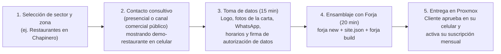

# 10 · Modelo de Negocio — *Website-as-a-Service* (WaaS) sobre Proxmox

Este documento estructura la operación comercial de **Forja Modular** para ofrecer sitios web dinámicos y con 3D a bajo costo para negocios de Bogotá, manteniendo alta rentabilidad y costos operativos mínimos gracias a tu infraestructura propia en **Proxmox VE**.

---

## 1. Propuesta de Valor al Comercio Local

Un dueño de restaurante, ferretería, consultorio o salón de belleza en Bogotá no quiere comprar "código Astro" ni administrar servidores. Quiere tres cosas concretas:
1. **Verse profesional y moderno en celulares** (con un toque visual 3D que lo diferencie de su competencia).
2. **Aparecer bien en Google y Google Maps** (SEO técnico + Schema.org `Restaurant`/`LocalBusiness` incluido por defecto).
3. **Recibir reservas o pedidos directo a su WhatsApp** sin pagar comisiones por pedido a plataformas intermediarias.

---

## 2. Estructura de Costos Unitarios (Tu Ventaja Competitiva)

Al generar sitios **100 % estáticos** servidos por un único contenedor Nginx endurecido en tu servidor Proxmox:

| Concepto | Costo Tradicional (WordPress por cliente) | Costo con Forja Modular en tu Proxmox |
|---|---|---|
| **Tiempo de armado inicial** | 15 a 30 horas | **15 a 30 minutos** (`forja new` + editar `site.json` + `forja build`) |
| **Consumo de RAM en servidor por sitio adicional** | ~256 MB – 512 MB (PHP + MySQL) | **< 1 MB** (archivos estáticos servidos por el mismo proceso Nginx) |
| **Mantenimiento de seguridad mensual** | Alto (parches semanales de plugins WordPress) | **Casi cero** (sin base de datos ni PHP expuestos en el sitio) |
| **SSL / CDN / Protección DDoS** | Variable | **\$0 USD** (plan gratuito de Cloudflare Tunnel + DNS) |

---

## 3. Esquema de Planes Sugerido (Pesos Colombianos — COP)

Modelo híbrido: **Pago único de activación (Setup)** + **Suscripción mensual todo incluido (WaaS)**.

| Plan | Ideal para | Activación (Pago Único) | Mensualidad | Qué incluye |
|---|---|---|---|---|
| **Plan Presencia 3D** | Cafés, panaderías, negocios de barrio que hoy solo tienen Instagram | \$180.000 COP | \$39.000 COP / mes | Sitio con plantilla sectorial + escena 3D del tema + carta hasta 25 productos + botón WhatsApp + mapa + subdominio `minegocio.tudominio.com` + SSL + 1 actualización de precios al mes. |
| **Plan Marca Propia** | Restaurantes establecidos, clínicas, ferreterías, salones | \$320.000 COP | \$65.000 COP / mes | Todo lo del Plan Presencia + conexión de dominio propio (`.com` o `.co`) + paleta de colores personalizada (`personalizacion.colores`) + galería de 12 fotos optimizadas + hasta 3 actualizaciones de carta/precios al mes. |
| **Plan Sistema Modular** *(Fase 5: Forja Apps)* | Negocios que requieren sistema interno con Login, Dashboard e Inventario/CRM | Desde \$1.200.000 COP | Desde \$180.000 COP / mes | Sitio público 3D + aplicación web privada con Login, Dashboard y módulos de base de datos desplegada en contenedor dedicado en Proxmox con backups diarios. |

*(Con solo 25 clientes activos en el Plan Marca Propia generas **\$1.625.000 COP/mes** recurrentes utilizando una sola VM de 2 GB de RAM en tu Proxmox).*

---

## 4. Flujo Comercial Paso a Paso (En 48 Horas)

### Checklist de Entrega por Cliente (`sites/<slug>/`)
- [ ] `slug` en minúsculas y sin caracteres especiales.
- [ ] Logo en `sites/<slug>/assets/` (preferiblemente `.svg` limpio o `.webp`).
- [ ] Precios verificados en pesos colombianos (enteros sin puntos ni comas en el JSON).
- [ ] Número de WhatsApp probado (`573...`).
- [ ] Datos del responsable en `legal.responsable` y `legal.emailDatos` para la página `/privacidad/`.
- [ ] `npm run validate` y `npm run forja -- build <slug>` sin errores.
