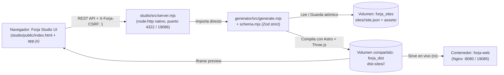

# 12 · Forja Studio — Constructor Visual Web (Fase 3)

**Forja Studio** es la interfaz gráfica y API REST de **Forja Modular** que permite crear, personalizar, previsualizar en vivo (Escritorio y Celular) y ensamblar sitios web 3D desde el navegador, sin editar archivos `site.json` manualmente.

---

## 1. Arquitectura de Forja Studio (Cero Duplicación)



### Decisiones Técnicas Clave
1. **Reutilización total del motor (`generator`):** `studio/src/server.mjs` no reimplementa validaciones ni reglas de negocio; importa directamente `cargarSitio`, `crearSitio`, `guardarSitio`, `guardarAssetSitio`, `construirSitio` y `escribirIndice` desde [generator/src/generate.mjs](file:///d:/piza77/proyectos/APLICACION__MODULAR/generator/src/generate.mjs).
2. **Cero dependencias externas adicionales:** El servidor usa `node:http`, `node:crypto` y `node:fs` nativos de Node 24, manteniendo la superficie de ataque y el árbol de paquetes al mínimo.
3. **Publicación instantánea en Proxmox mediante volumen compartido (`forja_dist`):** En [docker-compose.yml](file:///d:/piza77/proyectos/APLICACION__MODULAR/docker-compose.yml), `forja-studio` escribe los sitios ensamblados en el volumen `forja_dist` (`/app/dist-sites`) y `forja-web` (Nginx) lo monta en modo solo lectura (`:ro`). Al hacer clic en **"⚡ Guardar y Ensamblar 3D"**, el sitio queda publicado inmediatamente en `forja-web` (`19085`) sin reconstruir la imagen Docker.

---

## 2. Cómo Usarlo en Local y en Proxmox / Portainer

### 2.1 En tu computador local
```powershell
npm run studio
```
Abre `http://127.0.0.1:4322` en tu navegador.

### 2.2 En tu servidor Proxmox (`192.168.20.52`) con Portainer
Al actualizar el stack `forja-modular` en Portainer, se levantan dos contenedores:
- **`forja-web` (`192.168.20.52:19085` → `forja.homelab.lan`):** Servidor público Nginx de ultra bajo consumo con los sitios ya ensamblados.
- **`forja-studio` (`192.168.20.52:19086` → opcional `studio.homelab.lan`):** Panel visual de administración y ensamblaje.

---

## 3. Flujo de Trabajo en la Interfaz Visual

1. **Seleccionar o Crear un Negocio (`+ Nuevo negocio`):**
   - Escribes el nombre comercial (ej. *"Panadería La Espiga"*), el sistema genera automáticamente el `slug` (`panaderia-la-espiga`), eliges la plantilla (`restaurante`) y el tema inicial (`brasa`, `oceano` o `bosque`).
2. **Pestaña 1 — Tema, Colores y Logo:**
   - Cambia con un clic entre los temas del catálogo.
   - Ajusta cualquiera de los 7 *design tokens* de color con selectores visuales (`primario`, `secundario`, `acento`, `fondo`, `superficie`, `texto`, `textoSuave`) o restaura los colores originales del tema.
   - Sube el logo o imágenes del negocio (validadas automáticamente contra XSS en SVG y límite de 5 MB).
3. **Pestaña 2 — Negocio y Contacto:**
   - Edita nombre, categoría, eslogan, descripción, ciudad, barrio, dirección, WhatsApp, teléfono, correo, rango de precios, redes sociales (`https://`), búsqueda de Google Maps y horarios de atención.
4. **Pestaña 3 — Historia y Carta (Menú):**
   - Edita la historia del negocio, las tarjetas de cifras clave (hasta 4) y todas las categorías y platos de la carta (nombre, precio en COP, descripción y marca `★ Destacado`).
5. **Pestaña 4 — Opiniones, SEO y Ley 1581:**
   - Agrega o edita testimonios con calificación de estrellas, título/descripción SEO y los datos del responsable legal de tratamiento de datos personales (Ley 1581 de 2012).
6. **Guardar y Ensamblar 3D (`⚡ Guardar y Ensamblar 3D`):**
   - Valida todo el manifiesto con Zod en modo estricto, guarda `site.json` de forma atómica (`.tmp` → rename), ejecuta Astro + Three.js y refresca automáticamente el `iframe` de vista previa a la derecha (con conmutador **🖥️ Escritorio** / **📱 Celular**).

---

## 4. Controles de Seguridad de Forja Studio

| Control | Implementación en `studio/src/server.mjs` |
|---|---|
| **Autenticación en tiempo constante** | Si defines `STUDIO_TOKEN` en el entorno/Portainer, toda petición exige cookie `forja_token` (`HttpOnly; SameSite=Strict`) o cabecera `X-Forja-Token` comparada con `crypto.timingSafeEqual`. |
| **Protección Anti-CSRF** | Todas las peticiones `POST` y `PUT` exigen la cabecera personalizada `X-Forja-CSRF: 1` (que un formulario externo o sitio malicioso no puede enviar en peticiones cross-origin). |
| **Escritura Atómica de Manifiestos** | `guardarSitio()` escribe primero en `site.json.tmp` tras pasar `sitioSchema.safeParse()` y luego ejecuta `fs.rename`, evitando archivos JSON corruptos si ocurre un corte de energía. |
| **Bloqueo de Concurrencia en Builds** | El semáforo `buildEnCurso` impide que dos compilaciones simultáneas pisen `.forja/` o `dist-sites/` (devuelve `HTTP 409 Conflict`). |
| **Ejecución sin Root en Docker** | El stage `studio` del `Dockerfile` ejecuta `USER node` con `cap_drop: ALL` y `no-new-privileges: true`. |
