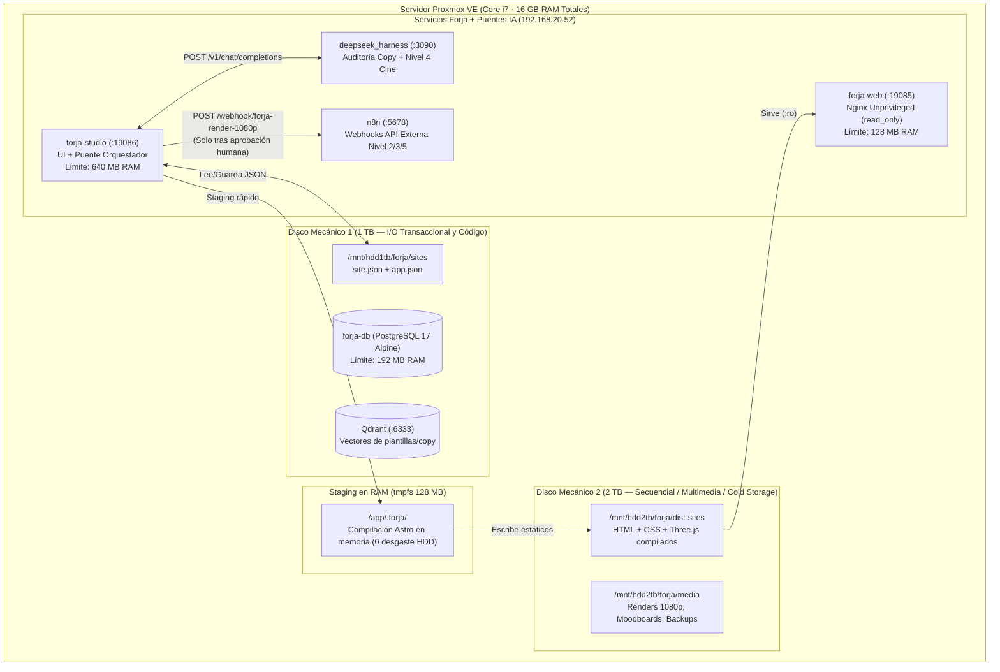

# 13 · Orquestación Homelab IA (16 GB RAM · HDD 1TB + 2TB) y Flujo Audiovisual en 5 Niveles

Este documento formaliza la arquitectura de integración entre **Forja Modular** y los demás stacks de tu Homelab en Proxmox (`192.168.20.52`: `deepseek_harness`, `claude-code`, `homelab-ia-suite`, `homelab-red-nube` y `n8n`), respetando las restricciones físicas de tu servidor (**Intel Core i7, 16 GB de RAM totales y 2 discos mecánicos de 1 TB y 2 TB**).

---

## 1. Pilar 1: Diagrama de Arquitectura, Presupuesto de RAM y Distribución de Discos



### Presupuesto Estricto de Memoria (16 GB Totales en el Host)

| Capa / Contenedor | RAM Reservada | Límite Duro (`limits.memory`) | Estado / Estrategia de Ahorro |
|---|---|---|---|
| **Hipervisor Proxmox VE + Kernel Linux** | ~2.0 GB | 2.5 GB | Siempre activo |
| **`forja-web` (Nginx Unprivileged :19085)** | 32 MB | **128 MB** | Siempre activo (consume ~25 MB reales sirviendo decenas de sitios) |
| **`forja-studio` (UI + Orquestador :19086)** | 128 MB | **640 MB** | Siempre activo (~55 MB en reposo, ~380 MB durante `astro build`) |
| **`forja-db` (PostgreSQL 17 Alpine :5432)** | 64 MB | **192 MB** | Perfil `db`: `shared_buffers=48MB`, `max_connections=25` |
| **Infraestructura Homelab (`adguard`, `npm`, `portainer`, `kuma`, `grafana`)** | ~1.5 GB | 2.5 GB | Siempre activos |
| **Stacks IA (`deepseek_harness`, `n8n`, `qdrant`, `claude-code`)** | ~3.0 GB | 6.0 GB | `deepseek_harness` en `:3090` y `n8n` en `:5678` activos; `claude-code` y `homelab-ia-suite` se encienden bajo demanda en Portainer |

---

## 2. Pilar 2: Flujo Audiovisual de Agencia en 5 Niveles (con *Human-in-the-Loop*)

Implementado en [generator/src/schema.mjs](file:///d:/piza77/proyectos/APLICACION__MODULAR/generator/src/schema.mjs) (`audiovisualSchema`), [studio/src/orchestrator.mjs](file:///d:/piza77/proyectos/APLICACION__MODULAR/studio/src/orchestrator.mjs) y la **Pestaña 5 (🎬 Estudio IA)** de **Forja Studio**:

| Nivel | Nombre | Campo en `site.json -> audiovisual` | Qué hace y quién lo ejecuta |
|---|---|---|---|
| **Nivel 1** | **Moodboard** | `nivel1Moodboard` | Ingesta referencias (`https://`), define `estiloVisual`, `ritmoEdicion` (`fast-pacing`, `cinematic-slow`, `dynamic-commercial`) y extrae `paletaExtraida` desde los *Design Tokens* del tema. |
| **Nivel 2** | **Ficha Técnica de Marca** | `nivel2FichaMarca` | Define un único `sujetoPrincipal` y sus 3 prompts maestros (`vistaFrontalPrompt`, `vistaLateralPrompt`, `detallesTexturaPrompt`) para garantizar consistencia visual total. |
| **Nivel 3** | **Construcción de 4 Tomas** | `nivel3Tomas` | Genera los 4 ángulos coherentes (`frontal` → `hero`, `lateral` → `nosotros`, `cenital` → `servicios`, `macro` → `detalle`) derivados del Nivel 2. |
| **Nivel 4** | **Dirección Cinematográfica** | `nivel4DireccionCine` | `deepseek_harness` traduce la idea simple del operador (`ideaOperador`) a especificaciones técnicas de óptica (`promptTecnicoCamara`), `iluminacionFisica` y `movimientoLente`. |
| **Nivel 5** | **Animación en 2 Pasos (Ahorro de Créditos)** | `nivel5Animacion` | **Paso 1:** Al generar el Nivel 4, el estado pasa a `borrador_generado`. **Paso 2 (Human-in-the-Loop):** El render final 1080p está bloqueado por código hasta que un humano presiona **"✅ Aprobar Borrador"** en Forja Studio, momento en que pasa a `aprobado_humano` / `render_1080p_listo` y notifica a `n8n`. |

---

## 3. Pilar 3: Gobierno de Datos ("Núcleo Forja")

Tanto **Forja Sitios** (`sitioSchema`) como **Forja Apps** (`appSchema`) están gobernados por validación de lista blanca en [generator/src/schema.mjs](file:///d:/piza77/proyectos/APLICACION__MODULAR/generator/src/schema.mjs):

- **Forja Sitios (`sites/<slug>/site.json`):** Gobierna plantilla sectorial, tema, personalización cromática, datos del negocio, carta/secciones, SEO, cumplimiento Ley 1581 y el bloque `audiovisual` de 5 niveles.
- **Forja Apps (`appSchema`):** Gobierna la generación de aplicaciones empresariales con:
  - `stack`: `frontend` (`react | vue | angular | astro-islands`), `backend` (`node-fastify | node-express | python-fastapi`), `baseDatos` (`postgresql | mysql`).
  - `uiTemplates`: selección de plantilla de `login` (`corporativo-split | minimal-glass | brutalista-3d`) y `dashboard` (`sidebar-ejecutivo | topbar-compacto | modular-cards`).
  - `modulosErp`: `login-rbac`, `tesoreria`, `recepcion-ocr`, `presupuestos`, `rrhh`, `inventarios`.
  - `entidades`: definición tipada de tablas (`snake_case`) y campos (`camelCase`) con tipos y restricciones.

---

## 4. Pilar 4: Comandos Exactos de Inicialización y Orden de Encendido en Proxmox

### 4.1 Preparar carpetas en los discos de 1 TB y 2 TB (en tu VM `192.168.20.52`)
Si tienes montados tus discos mecánicos en `/mnt/hdd1tb` y `/mnt/hdd2tb`:
```bash
sudo mkdir -p /mnt/hdd1tb/forja/sites /mnt/hdd1tb/forja/pgdata
sudo mkdir -p /mnt/hdd2tb/forja/dist-sites /mnt/hdd2tb/forja/media /mnt/hdd2tb/forja/backups
# Asignar permisos al usuario no-root del contenedor node (UID 1000) y nginx (UID 101)
sudo chown -R 1000:1000 /mnt/hdd1tb/forja/sites /mnt/hdd2tb/forja/dist-sites /mnt/hdd2tb/forja/media
```
*(Si prefieres no mapear rutas del host aún, los valores por defecto `forja_sites`, `forja_pgdata` y `forja_dist` funcionan automáticamente como volúmenes gestionados por Docker en Portainer).*

### 4.2 Orden recomendado de encendido de contenedores (Protección de 16 GB RAM)
1. **Red y DNS base:** `adguard` (`:8083`) + `proxy` (Nginx Proxy Manager `:81`).
2. **Núcleo Forja Modular (siempre activo, < 150 MB RAM combinados en reposo):**
   - `forja-web` (`:19085`)
   - `forja-studio` (`:19086`)
3. **Agente de Texto y Automatización (cuando vayas a crear/auditar clientes en Forja Studio):**
   - `deepseek_harness` (`:3090`)
   - `n8n` (`:5678`)
4. **Base de datos relacional (cuando actives persistencia multi-usuario Fase 2):**
   - `forja-db` (`docker compose -f docker-compose.yml -f docker-compose.override.example.yml --profile db up -d`)
5. **Generador de código pesado (`claude-code`):**
   - Encender en Portainer únicamente durante sesiones de desarrollo de nuevas plantillas o módulos de **Forja Apps**, y apagar al terminar para liberar RAM.
